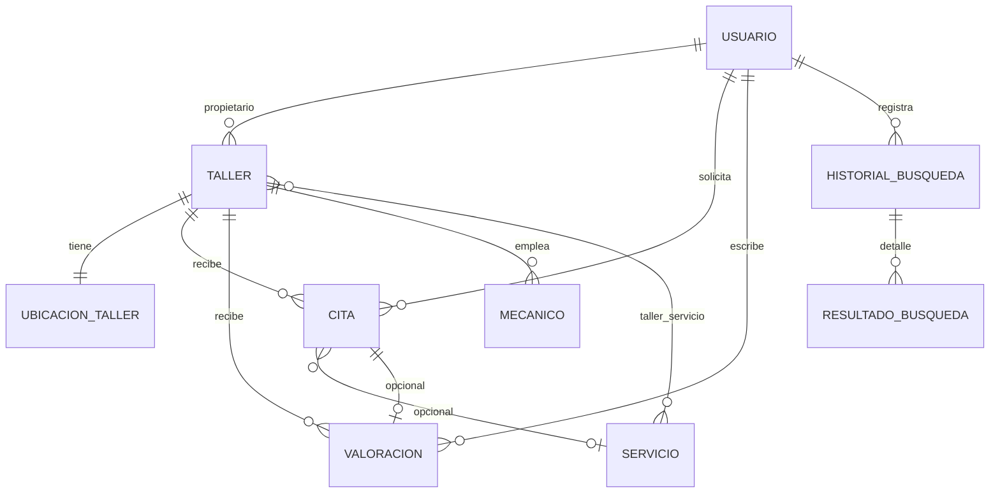

# Material de estudio — Asistencia en carretera

Documento para **sustentar el proyecto** (4° semestre): rutas, vistas, JDBC, inyección de dependencias, seguridad básica y preguntas frecuentes del profesor.

**Contenido ampliado (estudiar antes de la sustentación):**
- Secciones **1–15:** rutas, vistas, flujos, preguntas base
- Sección **16:** stack tecnológico (Maven, Spring, MySQL, Leaflet, etc.)
- Sección **17:** base de datos (ER, FK, tablas, JOINs, mapeo a Java)
- Sección **18:** **60 preguntas** con temas A–H
- Sección **19:** glosario

---

## 1. Resumen del proyecto

| Aspecto | Detalle |
|--------|---------|
| **Nombre** | Asistencia en carretera |
| **Objetivo** | Buscar talleres en mapa, pedir citas y dejar valoraciones |
| **Stack** | Spring Boot 4 + Thymeleaf + MySQL + JavaScript (Leaflet + OpenStreetMap) |
| **BD** | `asistencia_en_carretera` (script `sql/02_asistencia_en_carretera.sql`) |
| **Puerto** | `http://localhost:8080` |

### Roles de usuario (`tabla usuario.rol`)

| Rol en BD | Rol en sesión (front) | Pantalla principal |
|-----------|----------------------|-------------------|
| `admin` | `admin` | `/mi-taller` — administración |
| `user` | `user` | `/buscar-talleres` — cliente |
| `taller` | `taller` | `/panel-taller` — dueño del taller |

Contraseña demo en SQL: texto plano `demo` (proyecto educativo; en producción usar hash).

---

## 2. Arquitectura en capas (cómo explicarlo)

```
Navegador (HTML + CSS + JS)
        │
        ▼
Controllers  ──►  reciben HTTP, devuelven vista o JSON
        │
        ▼
TallerService (interfaz)  ◄── inyección de dependencias
        │
        ▼
TallerServiceJdbcImpl  ──►  JdbcTemplate  ──►  MySQL
```

**Frase para sustentación:**  
*"Separamos la interfaz web (controladores) de la lógica de negocio (servicio) y de los datos (JDBC). Spring conecta las piezas sin que yo haga `new TallerServiceJdbcImpl()` a mano en cada clase."*

---

## 3. Inyección de dependencias (DI)

### ¿Qué es?

Spring **crea y entrega** los objetos que una clase necesita por el **constructor**, en lugar de instanciarlos dentro de la clase.

### Ejemplos en el proyecto

**1) `VistaController` recibe el servicio:**

```java
@Controller
public class VistaController {
    private final TallerService tallerService;

    public VistaController(TallerService tallerService) {
        this.tallerService = tallerService;
    }
}
```

**2) `TallerServiceJdbcImpl` recibe `JdbcTemplate`:**

```java
@Service
public class TallerServiceJdbcImpl implements TallerService {
    private final JdbcTemplate jdbc;

    public TallerServiceJdbcImpl(JdbcTemplate jdbc) {
        this.jdbc = jdbc;
    }
}
```

**3) `WebMvcConfig` recibe el interceptor:**

```java
public WebMvcConfig(SessionRequiredInterceptor sessionRequiredInterceptor) {
    this.sessionRequiredInterceptor = sessionRequiredInterceptor;
}
```

### Preguntas típicas y respuestas

| Pregunta | Respuesta corta |
|----------|-----------------|
| ¿Por qué una interfaz `TallerService`? | Para desacoplar el controlador de la implementación; hoy es JDBC, mañana podría ser otra cosa. |
| ¿Quién implementa `TallerService`? | `TallerServiceJdbcImpl`, marcada con `@Service`. |
| ¿Quién crea `JdbcTemplate`? | Spring Boot al detectar `spring-boot-starter-jdbc` y `application.properties` con la URL de MySQL. |
| ¿Qué es `@Controller` vs `@RestController`? | `@Controller` devuelve nombres de plantillas HTML; `@RestController` devuelve JSON directamente. |
| ¿Qué es `@Component`? | Marca una clase para que Spring la registre (ej. interceptor). |

---

## 4. JDBC y `JdbcTemplate`

### ¿Qué es JDBC?

API estándar de Java para hablar con bases de datos SQL. En Spring usamos **`JdbcTemplate`** para no repetir código de conexión, cierre y manejo de errores.

### Configuración (`application.properties`)

```properties
spring.datasource.url=jdbc:mysql://localhost:3306/asistencia_en_carretera?...
spring.datasource.username=taller_app
spring.datasource.password=taller123
```

### Operaciones que hace el proyecto

| Método JdbcTemplate | Uso en el proyecto |
|---------------------|-------------------|
| `query(...)` | Listar talleres, citas, valoraciones |
| `queryForObject(...)` | Contar filas, obtener un id |
| `update(...)` | INSERT, UPDATE |

### Ejemplo real — login (`AuthController`)

```java
String sql = """
    SELECT id, nombre, rol FROM usuario
    WHERE email = ? AND password_hash = ? AND COALESCE(activo, 0) = 1
    LIMIT 1
    """;
jdbc.query(sql, (rs, rowNum) -> ..., em, password);
```

Los `?` son **parámetros enlazados**: el valor va aparte del texto SQL.

### Ejemplo real — listar talleres con JOIN

En `TallerServiceJdbcImpl.listarTodos()` se hace `JOIN` con `ubicacion_taller` (dirección, lat, lng) y agregación de `valoracion` (promedio y cantidad).

### Guardar taller

1. Tabla `taller` (nombre, teléfono, horario, etc.)
2. Tabla `ubicacion_taller` (dirección, ciudad, **lat**, **lng**) — necesario para el mapa
3. Si es nuevo dueño: `INSERT` en `usuario` con rol `taller`
4. Si faltan coordenadas: `GeocodificacionOpenStreetMap` (HTTP a Nominatim) o valores por defecto Cartagena

---

## 5. Inyección SQL — qué decir en la sustentación

### ¿Qué es?

Ataque donde el usuario mete texto malicioso en un formulario y altera la consulta SQL (ej. `' OR '1'='1`).

### ¿Cómo lo evitamos?

**Usar siempre parámetros `?`**, nunca concatenar strings:

```java
// BIEN — parametrizado
jdbc.update("UPDATE taller SET nombre=? WHERE id=?", nombre, id);

// MAL — nunca hacer esto
jdbc.update("UPDATE taller SET nombre='" + nombre + "' WHERE id=" + id);
```

En el proyecto **no** armamos SQL con `+` y datos del usuario. Thymeleaf y Spring también enlazan valores en formularios de forma controlada.

### Limitación honesta del proyecto

- Contraseñas en demo están en claro en BD (no es seguro para producción).
- No hay HTTPS ni tokens JWT; la sesión es **cookie de sesión HTTP** (`HttpSession`).

---

## 6. Sesión y seguridad de rutas

### Flujo de login

1. Usuario envía formulario en `/` → `script.js` hace `POST /api/auth/login`
2. `AuthController` valida en MySQL y guarda en sesión:
   - `usuarioId`, `rol`, `nombre`
3. Redirección según rol: admin → `/mi-taller`, taller → `/panel-taller`, user → `/buscar-talleres`

### Interceptor global

`SessionRequiredInterceptor` + `WebMvcConfig`:

- **Público:** `/`, `/css/*`, `/js/*`, `/api/auth/login`, `/logout`
- **Resto:** exige `session.getAttribute("usuarioId")` o redirige a `/`

### Control por rol en controladores

Además del interceptor, `VistaController` usa métodos privados:

- `redirectSiNoEsAdmin` → solo admin en `/mi-taller`, `/registrar-taller`
- `redirectSiNoEsCliente` → solo `user` en citas/valoraciones del cliente
- `redirectSiNoEsTaller` → solo `taller` en `/panel-taller`

---

## 7. Catálogo de rutas

### Vistas HTML (Thymeleaf) — `VistaController`

| Método | Ruta | Plantilla | Quién | Qué hace |
|--------|------|-----------|-------|----------|
| GET | `/` | `index.html` | Público | Login |
| GET | `/logout` | — | Todos | Cierra sesión → `/` |
| GET | `/buscar-talleres` | `buscar-talleres.html` | Sesión (cliente completo si `user`) | Mapa, búsqueda, citas, valoraciones, historial |
| GET | `/mi-taller` | `mi-taller.html` | Admin | Tablas: talleres, citas, valoraciones |
| GET | `/registrar-taller` | `registrar-taller.html` | Admin | Formulario alta/edición |
| POST | `/registrar-taller` | redirect | Admin | Guarda en BD → `#seccion-talleres` |
| GET | `/panel-taller` | `panel-taller.html` | Dueño `taller` | Citas de sus talleres |
| GET | `/detalle-taller?id=` | `detalle-taller.html` | Sesión | Ficha de un taller |
| GET | `/valoraciones` | redirect | Admin | → `/mi-taller#seccion-valoraciones` |
| GET | `/citas-pendientes` | redirect | Admin | → `/mi-taller#seccion-citas` |
| GET | `/calificar-taller` | redirect | Cliente | → buscar-talleres `?ver=calificar` |
| POST | `/calificar-taller` | redirect | Cliente | Guarda valoración |
| GET | `/solicitar-cita` | redirect | Cliente | → buscar-talleres `?ver=solicitar` |
| POST | `/solicitar-cita` | redirect | Cliente | Inserta cita |
| GET | `/historial-busquedas` | redirect | Cliente | → `?ver=historial` |

### API REST (JSON)

| Método | Ruta | Controlador | Qué hace |
|--------|------|-------------|----------|
| POST | `/api/auth/login` | `AuthController` | Valida usuario, crea sesión, JSON `{ok, rol, nombre...}` |
| GET | `/api/talleres` | `TalleresController` | Lista todos los talleres (para el mapa en JS) |
| GET | `/api/historial-busqueda` | `HistorialBusquedaApiController` | Historial del usuario logueado |
| POST | `/api/historial-busqueda` | `HistorialBusquedaApiController` | Guarda término de búsqueda al pulsar Buscar |

---

## 8. Qué hace cada vista (estudio por pantalla)

### `index.html` — Login

- **JS:** `static/js/script.js`
- **Backend:** `POST /api/auth/login`
- **No usa Thymeleaf dinámico** (página estática con fetch)

### `buscar-talleres.html` — Cliente (pantalla principal)

- **Backend GET:** carga `talleresBd`, citas del cliente, formulario de valoración, taller preseleccionado para cita (`tallerCita`).
- **JS:** `buscar-talleres.js`
  - Mapa Leaflet + tiles OpenStreetMap
  - `GET /api/talleres` → marcadores solo si hay `lat` y `lng`
  - Filtro local por texto (nombre, ciudad, dirección, servicios)
  - `POST /api/historial-busqueda` al buscar
  - Geocodificación cliente con Nominatim (referencia de búsqueda en mapa)
- **Formularios en la misma página:**
  - `POST /solicitar-cita` — pedir cita
  - `POST /calificar-taller` — valorar por nombre de taller

### `mi-taller.html` — Administrador

- Tablas con paginación y búsqueda en el navegador (`mi-taller.js`)
- Enlaces: registrar taller, editar (`/registrar-taller?id=`), ver ficha cliente
- Datos: `tallerService.listarTodos()`, `listarTodasCitas()`, `listarTodasValoraciones()`

### `registrar-taller.html` — Alta/edición taller

- **POST** con `@ModelAttribute Taller` — Spring llena el objeto desde el formulario
- Campos: datos del taller + ubicación (ciudad, lat, lng) + dueño (solo en alta)
- **JS:** `registrar-taller.js` — botón para consultar coordenadas en Nominatim
- **Servicio:** `guardar(taller, uid, esAdmin)` → tablas `taller`, `ubicacion_taller`, opcional `usuario`

### `panel-taller.html` — Dueño del taller

- Ve **solo citas** de talleres donde él es `propietario_usuario_id`
- `listarTalleresDelPropietario(uid)`, `listarCitasPorPropietario(uid)`

### `detalle-taller.html` — Ficha pública

- Muestra un taller por `id` (o el último si no hay id)
- Valoraciones de ese taller: `listarValoracionesPorTaller(id)`

---

## 9. JavaScript del frontend (por archivo)

| Archivo | Pantalla | Función principal |
|---------|----------|-------------------|
| `script.js` | Login | `fetch` login, redirección por rol |
| `app.js` | Varias | Utilidades menú / sesión en cliente |
| `buscar-talleres.js` | Mapa cliente | Leaflet, API talleres, historial, filtros |
| `mi-taller.js` | Admin | Paginación y filtro de tablas en HTML |
| `registrar-taller.js` | Registrar | Rellenar lat/lng con Nominatim |

---

## 10. Modelo de datos (tablas usadas en código)

| Tabla | Para qué |
|-------|----------|
| `usuario` | Login, dueños, clientes, admin |
| `taller` | Negocio mecánico |
| `ubicacion_taller` | Dirección y **coordenadas del mapa** |
| `cita` | Solicitudes de servicio |
| `valoracion` | Estrellas y comentarios |
| `historial_busqueda` | Términos buscados en el mapa |

Tablas en SQL pero poco usadas en la app actual: `mecanico`, `servicio`, `taller_servicio`, `resultado_historial`.

Ver también: `MODELO_RELACIONAL.md`, `sql/02_asistencia_en_carretera.sql`.

---

## 11. Flujos importantes (para dibujar en el examen)

### A) Crear taller y verlo en el mapa

```
Admin → /registrar-taller (form)
     → POST /registrar-taller
     → TallerServiceJdbcImpl.guardar()
     → INSERT taller + ubicacion_taller (con lat/lng)
Cliente → /buscar-talleres
     → buscar-talleres.js → GET /api/talleres
     → Leaflet.marker([lat, lng])
```

### B) Pedir cita

```
Cliente → formulario en buscar-talleres
       → POST /solicitar-cita
       → agregarCita() → INSERT cita
Admin   → /mi-taller#seccion-citas ve la cita
Dueño   → /panel-taller ve citas de su taller
```

### C) Valorar taller

```
Cliente → POST /calificar-taller
       → registrarCalificacion() → INSERT valoracion
       → Promedio se recalcula en consultas con JOIN/AVG
```

---

## 12. Preguntas de sustentación (con respuesta modelo)

### Spring y arquitectura

1. **¿Por qué Spring Boot?**  
   Arranque rápido, servidor embebido, configuración por `application.properties`, integración con JDBC y Thymeleaf.

2. **¿Qué es Thymeleaf?**  
   Motor de plantillas HTML: el servidor rellena datos (`th:text`, `th:each`) antes de enviar la página.

3. **¿Qué es un `@ModelAttribute`?**  
   Enlaza los campos del formulario HTML a un objeto Java (`Taller`) en un POST.

4. **¿Qué es `RedirectAttributes`?**  
   Mensajes flash (`msgOk`, `msgError`) que sobreviven una redirección.

### Base de datos

5. **¿Por qué dos tablas `taller` y `ubicacion_taller`?**  
   Separar datos del negocio de la geolocalización (1:1); el mapa lee lat/lng de ubicación.

6. **¿Qué es un JOIN?**  
   Unir tablas en una consulta; ejemplo: taller + ubicación + promedio de valoraciones.

7. **¿Índices en el script?**  
   Sí, en FK y campos de búsqueda (`idx_taller_propietario`, etc.).

### Seguridad

8. **¿Cómo autentican?**  
   Sesión HTTP tras validar email/password en BD.

9. **¿Cómo autorizan por rol?**  
   Interceptor (logueado) + comprobaciones en controlador (rol correcto).

10. **¿Riesgo de inyección SQL?**  
    Mitigado con parámetros `?` en JdbcTemplate; no concatenar SQL con input del usuario.

### Mapa

11. **¿De dónde salen las coordenadas?**  
    Script demo en SQL; al registrar, formulario + geocodificación OpenStreetMap + guardado en `ubicacion_taller`.

12. **¿Por qué un taller no aparece en el mapa?**  
    Si `lat` o `lng` son NULL, `buscar-talleres.js` no crea marcador (sí puede listar la tarjeta).

---

## 13. Estructura de carpetas (memorizar)

```
Backend/talleres/src/main/java/com/tecnologico/talleres/
├── TalleresApplication.java      # main Spring Boot
├── controllers/                  # HTTP entrada
├── services/                     # interfaz negocio
│   └── impl/TallerServiceJdbcImpl.java
├── model/                        # POJOs (Taller, Cita, ...)
├── dto/                          # LoginResponse, HistorialBusquedaRequest
├── util/GeocodificacionOpenStreetMap.java
└── web/                          # Interceptor + WebMvcConfig

src/main/resources/
├── application.properties
├── templates/                    # HTML Thymeleaf
└── static/css, static/js         # assets
```

---

## 14. Cómo ejecutar y demostrar (checklist)

1. MySQL: ejecutar `01_crear_usuario_mysql.sql` y `02_asistencia_en_carretera.sql`
2. `cd Backend/talleres` → `mvn spring-boot:run`
3. Login admin → registrar taller con ciudad y coordenadas → ver en `/mi-taller`
4. Login cliente → `/buscar-talleres` → ver marcador y pedir cita
5. Login `taller1@demo.local` → `/panel-taller` → ver citas

---

## 15. Limitaciones (decirlas con honestidad — suma puntos)

- Contraseñas demo sin hash real
- Sin registro público de usuarios (solo admin crea dueños)
- Geocodificación depende de internet (Nominatim)
- Paginación del admin es en JavaScript (no en SQL)
- No hay pruebas unitarias automatizadas en el repo

---

## 16. Stack tecnológico — detalle completo

### 16.1 Lenguajes y entorno

| Tecnología | Versión / detalle | Para qué la usamos |
|------------|-------------------|-------------------|
| **Java** | 17 (`pom.xml`) | Lógica del servidor, JDBC, Spring |
| **HTML5** | — | Estructura de páginas |
| **CSS3** | `static/css/estilos.css`, `styles.css` | Diseño login y app |
| **JavaScript** | Vanilla (sin React/Angular) | Login, mapa, paginación tablas |
| **SQL** | MySQL 8 dialect | Esquema y consultas |

### 16.2 Backend (Spring Boot)

| Componente | Dependencia Maven | Función en el proyecto |
|------------|-------------------|------------------------|
| **Spring Boot** | parent `4.0.3` | Arranque embebido (Tomcat), configuración automática |
| **spring-boot-starter-webmvc** | pom.xml | Controladores HTTP, REST, MVC |
| **spring-boot-starter-thymeleaf** | pom.xml | Plantillas HTML en servidor (`templates/`) |
| **spring-boot-starter-jdbc** | pom.xml | `DataSource`, `JdbcTemplate` |
| **mysql-connector-j** | runtime | Driver JDBC hacia MySQL |
| **Tomcat embebido** | incluido en web | Servidor en puerto 8080 |

**No usamos en este proyecto:** JPA/Hibernate, Spring Security, React, Angular, Redis, Docker (opcional en tu máquina).

### 16.3 Base de datos y conexión

| Elemento | Valor |
|----------|--------|
| Motor | **MySQL** (InnoDB) |
| Base de datos | `asistencia_en_carretera` |
| Charset | `utf8mb4` / `utf8mb4_unicode_ci` (tildes y emojis) |
| Usuario app | `taller_app` / `taller123` (`sql/01_crear_usuario_mysql.sql`) |
| Config | `Backend/talleres/src/main/resources/application.properties` |
| Acceso | **JDBC** directo vía `JdbcTemplate` (no ORM) |

### 16.4 Frontend y mapas

| Tecnología | Dónde | Rol |
|------------|-------|-----|
| **Thymeleaf** | `templates/*.html` | El servidor inserta datos de BD en HTML (`th:each`, `th:text`) |
| **Leaflet** | CDN en `buscar-talleres.html` | Mapa interactivo (zoom, marcadores) |
| **OpenStreetMap** | Tiles URL en `buscar-talleres.js` | Imágenes del mapa (gratuito) |
| **Nominatim** | fetch desde JS y Java | Convertir dirección → lat/lng |
| **Fetch API** | `script.js`, `buscar-talleres.js` | Llamadas AJAX al backend |

### 16.5 Herramientas de desarrollo

| Herramienta | Uso |
|-------------|-----|
| **Maven** | Compilar, descargar dependencias (`mvn spring-boot:run`) |
| **IntelliJ / VS Code / Cursor** | Editar código |
| **MySQL Workbench / línea de comandos** | Ejecutar scripts SQL |
| **Git** | Control de versiones del repositorio |

### 16.6 Patrón arquitectónico

**MVC adaptado:**

- **Model:** clases `model/` + tablas MySQL + `TallerService`
- **View:** Thymeleaf + CSS + JS
- **Controller:** `VistaController`, `AuthController`, APIs REST

**Capa de servicio adicional** entre Controller y JDBC (buena práctica aunque el curso solo pida MVC).

---

## 17. Base de datos — relaciones y diseño

### 17.1 Diagrama entidad-relación (como está en MySQL)



### 17.2 Cardinalidad en palabras simples

| Relación | Tipo | Significado |
|----------|------|-------------|
| `usuario` → `taller` | **1 : N** | Un usuario dueño puede tener uno o más talleres (en demo: 1 dueño = 1 taller) |
| `taller` → `ubicacion_taller` | **1 : 1** | Cada taller tiene una fila de ubicación (`UNIQUE taller_id`) |
| `usuario` → `cita` | **1 : N** | Un cliente puede pedir muchas citas |
| `taller` → `cita` | **1 : N** | Un taller recibe muchas citas |
| `usuario` → `valoracion` | **1 : N** | Un cliente puede valorar varias veces (varios talleres) |
| `taller` → `valoracion` | **1 : N** | Un taller tiene muchas valoraciones |
| `taller` ↔ `servicio` | **N : M** | Tabla intermedia `taller_servicio` (catálogo; poco usada en app) |
| `historial_busqueda` → `resultado_busqueda` | **1 : N** | Previsto para guardar cada resultado; **la app actual solo usa historial** |

### 17.3 Tabla por tabla (campos clave)

#### `usuario` — personas que entran al sistema

| Campo | Tipo | Notas |
|-------|------|-------|
| `id` | BIGINT PK | Identificador |
| `email` | VARCHAR UK | Login único |
| `password_hash` | VARCHAR | En demo guardamos `demo` en claro |
| `nombre` | VARCHAR | Nombre mostrado |
| `rol` | ENUM check | `admin`, `user`, `taller` |
| `activo` | BOOLEAN | Si FALSE no puede entrar |

**Relación:** un `usuario` con rol `taller` es **propietario** de filas en `taller` (`propietario_usuario_id`).

#### `taller` — negocio mecánico

| Campo | Tipo | Notas |
|-------|------|-------|
| `id` | BIGINT PK | |
| `propietario_usuario_id` | FK → usuario | Dueño del negocio |
| `nombre`, `telefono`, `descripcion` | | Datos del formulario admin |
| `horario`, `servicios_texto` | | Texto libre (no tabla servicio obligatoria) |
| `estado` | | `publicado` en demo |

**FK:** `ON DELETE RESTRICT` — no puedes borrar un usuario si tiene talleres.

#### `ubicacion_taller` — dónde está en el mapa

| Campo | Tipo | Notas |
|-------|------|-------|
| `taller_id` | FK UK | **Una** ubicación por taller |
| `direccion_texto`, `ciudad` | | Formulario registrar-taller |
| `lat`, `lng` | DECIMAL | **Obligatorios para marcador en Leaflet** |
| `departamento`, `pais` | | Default Bolívar / CO |

**FK:** `ON DELETE CASCADE` — si se borra el taller, se borra su ubicación.

#### `cita` — solicitud del cliente

| Campo | Tipo | Notas |
|-------|------|-------|
| `usuario_id` | FK | Cliente (`user`) |
| `taller_id` | FK | Taller elegido |
| `servicio_id` | FK nullable | No obligatorio en la app actual |
| `fecha_hora` | TIMESTAMP | Une fecha + hora del formulario |
| `estado` | CHECK | `solicitada`, `confirmada`, `cancelada`, `completada` |
| `notas_usuario` | TEXT | Guarda nombre contacto + motivo (texto libre) |

**Relación lógica:** cliente **N** — **1** taller por cita.

#### `valoracion` — opinión del cliente

| Campo | Tipo | Notas |
|-------|------|-------|
| `usuario_id` | FK | Quién valora |
| `taller_id` | FK | Taller valorado |
| `cita_id` | FK nullable | Opcional (en demo suele ser NULL) |
| `estrellas` | 1–5 | CHECK constraint |
| `comentario` | TEXT | |

**Cálculo en app:** promedio con `AVG(estrellas)` y `COUNT(*)` en consulta de listado (no columna guardada en `taller`).

#### `historial_busqueda` — búsquedas en el mapa

| Campo | Tipo | Notas |
|-------|------|-------|
| `usuario_id` | FK | Cliente logueado |
| `termino` | VARCHAR | Texto del buscador |
| `origen_lat`, `origen_lng` | | Punto de referencia del mapa |
| `resultados` | INT | Cuántos talleres coincidieron |
| `origen` | | Siempre `buscador` |

#### Tablas en esquema pero **casi no usadas** por la app Java actual

| Tabla | Estado |
|-------|--------|
| `mecanico` | Solo en SQL; sin pantalla |
| `servicio` / `taller_servicio` | Modelo normalizado; la app usa `servicios_texto` en `taller` |
| `resultado_busqueda` | Prevista para detalle por búsqueda; no se inserta desde Java aún |

### 17.4 Integridad referencial (ON DELETE)

| FK | Comportamiento | Por qué |
|----|----------------|---------|
| taller → usuario | RESTRICT | No borrar dueño con taller activo |
| ubicacion → taller | CASCADE | Ubicación depende del taller |
| cita → usuario/taller | RESTRICT | Historial de citas protegido |
| valoracion → taller | CASCADE | Si se borra taller, se borran sus reseñas |
| historial → usuario | CASCADE | Si se borra usuario, su historial se va |

### 17.5 Consultas JOIN que usa la aplicación

**Listar talleres para el mapa** (`listarTodos`):

```sql
FROM taller t
LEFT JOIN ubicacion_taller ubi ON ubi.taller_id = t.id
LEFT JOIN usuario usr ON usr.id = t.propietario_usuario_id
LEFT JOIN (
  SELECT taller_id, AVG(estrellas) AS prom, COUNT(*) AS cnt
  FROM valoracion GROUP BY taller_id
) va ON va.taller_id = t.id
```

**Listar citas admin** — JOIN `taller` para mostrar nombre del taller.

**Listar valoraciones admin** — JOIN `usuario` + `taller`.

### 17.6 Mapeo BD → Java → pantalla

| Tabla(s) | Clase Java | Pantalla / API |
|----------|------------|----------------|
| usuario | (sin entidad JPA; login directo) | `index`, `AuthController` |
| taller + ubicacion_taller | `Taller` | `mi-taller`, `/api/talleres`, mapa |
| cita | `Cita` | `buscar-talleres`, `mi-taller`, `panel-taller` |
| valoracion | `Valoracion` | `detalle-taller`, `mi-taller`, formulario calificar |
| historial_busqueda | `BusquedaHistorial` | `buscar-talleres`, API historial |

### 17.7 Datos demo (memorizar para demo oral)

- **12 usuarios:** 1 admin, 1 cliente, 10 dueños de taller
- **10 talleres** en Cartagena/Turbaco con **coordenadas reales**
- **1 cita** de ejemplo (cliente → taller 1)
- **15 valoraciones** del cliente hacia distintos talleres
- **historial_busqueda:** vacío al instalar; se llena al usar Buscar en el mapa

---

## 18. Banco ampliado de preguntas (sustentación)

### A. Proyecto y negocio

1. ¿Qué problema resuelve la aplicación?  
2. ¿Quiénes son los actores (admin, cliente, dueño)?  
3. ¿Por qué un mapa y no solo una lista?  
4. ¿Qué pasa si un taller no tiene coordenadas?  
5. ¿Cómo se calcula la calificación promedio de un taller?

### B. Tecnologías

6. ¿Por qué Spring Boot y no solo Servlets?  
7. ¿Qué es Maven y para qué sirve el `pom.xml`?  
8. ¿Qué es Thymeleaf y en qué se diferencia de HTML estático?  
9. ¿Qué es Leaflet y qué datos necesita?  
10. ¿Qué es OpenStreetMap y es de pago?  
11. ¿Qué es Nominatim?  
12. ¿Por qué Java 17?  
13. ¿Qué servidor HTTP usa la app? (Tomcat embebido)  
14. ¿Usan JPA o Hibernate? (No, JDBC)  
15. ¿Por qué no usaron un framework frontend pesado?

### C. Base de datos

16. ¿Cuántas tablas tiene el proyecto? (10 en el script)  
17. ¿Cuál es la PK y FK de `taller`?  
18. Explique la relación entre `taller` y `ubicacion_taller`.  
19. ¿Por qué separar ubicación del taller?  
20. ¿Qué es una clave única (`UNIQUE email`)?  
21. ¿Qué es `ON DELETE CASCADE`? Dé un ejemplo del proyecto.  
22. ¿Qué es `ON DELETE RESTRICT`? Dé un ejemplo.  
23. ¿Qué roles existen en `usuario.rol`?  
24. ¿Qué guarda la tabla `cita`?  
25. ¿Puede una valoración existir sin cita? (Sí, `cita_id` nullable)  
26. ¿Qué es el CHECK de estrellas 1–5?  
27. ¿Para qué sirve `utf8mb4`?  
28. ¿Qué usuario usa la aplicación para conectarse a MySQL?  
29. ¿Dónde está la URL de conexión?  
30. ¿Qué es un índice (`idx_cita_taller`) y para qué sirve?

### D. JDBC y SQL

31. ¿Qué es JDBC?  
32. ¿Qué hace `JdbcTemplate`?  
33. ¿Qué es un `PreparedStatement` / parámetro `?`?  
34. ¿Qué es inyección SQL y cómo lo evitan?  
35. ¿Qué es un JOIN y cuántos tipos menciona? (INNER, LEFT — usamos LEFT)  
36. ¿Qué es una subconsulta? (Ejemplo del AVG en valoraciones)  
37. ¿Qué operación usa para insertar una cita?  
38. ¿Cómo obtienen el siguiente id? (`MAX(id)+1` en el servicio)  
39. ¿Qué es una transacción? (En el proyecto muchas operaciones son un solo `update`; se puede mencionar como mejora)  
40. ¿Qué es `queryForObject` vs `query`?

### E. Spring e inyección de dependencias

41. ¿Qué es el contenedor IoC de Spring?  
42. ¿Qué significa `@Service`, `@Controller`, `@RestController`?  
43. ¿Qué es inyección por constructor y ventaja?  
44. ¿Por qué programar contra `TallerService` y no la implementación?  
45. ¿Qué es `@ModelAttribute`?  
46. ¿Qué es `RedirectAttributes` / flash attributes?  
47. ¿Qué hace `@GetMapping` vs `@PostMapping`?  
48. ¿Qué es un `@RestController`?  
49. ¿Qué es el `application.properties`?  
50. ¿Qué es un interceptor en Spring MVC?

### F. Seguridad y sesión

51. ¿Cómo funciona el login?  
52. ¿Dónde se guarda la sesión? (Servidor — `HttpSession`)  
53. ¿Qué atributos hay en sesión? (`usuarioId`, `rol`, `nombre`)  
54. ¿Qué rutas son públicas?  
55. ¿Cómo impiden que un cliente entre a `/mi-taller`?  
56. ¿Es seguro guardar la contraseña `demo` en texto plano? (No — mejora futura)  
57. ¿Qué es autenticación vs autorización?  
58. ¿Usan JWT? (No, sesión clásica)  
59. ¿Qué pasa si no hay cookie de sesión? (Redirige a `/`)  
60. ¿Qué es CSRF y lo tienen? (Formularios simples; mencionar como mejora con Spring Security)

### G. Frontend y flujos

61. ¿Cómo carga el mapa los talleres? (`GET /api/talleres`)  
62. ¿Qué hace el botón Buscar en el mapa?  
63. ¿Dónde se guarda el historial de búsqueda?  
64. ¿Cómo funciona la paginación en `mi-taller.js`?  
65. ¿Qué es `fetch` y `credentials: same-origin`?  
66. ¿Por qué admin y cliente usan pantallas distintas tras login?

### H. Respuestas rápidas “una línea”

| Pregunta corta | Respuesta |
|----------------|-----------|
| ¿ORM? | No, JDBC manual |
| ¿BD? | MySQL `asistencia_en_carretera` |
| ¿Mapa? | Leaflet + OSM |
| ¿Coordenadas? | Tabla `ubicacion_taller` |
| ¿DI? | Constructor + Spring |
| ¿Capas? | Controller → Service → JDBC |

---

## 19. Glosario (términos del profesor)

| Término | Significado en tu proyecto |
|---------|---------------------------|
| **API REST** | URLs como `/api/talleres` que devuelven JSON |
| **DTO** | `LoginResponse`, `HistorialBusquedaRequest` — objetos para transferir datos |
| **POJO** | `Taller`, `Cita` — clases simples sin anotaciones JPA |
| **FK** | Columna que apunta a PK de otra tabla |
| **PK** | Identificador único de fila |
| **Sesión** | Memoria en servidor que recuerda quién inició sesión |
| **Redirect** | `return "redirect:/mi-taller"` — segunda petición GET |
| **Flash message** | `msgOk` / `msgError` una sola vez tras redirect |
| **Geocodificación** | Dirección → lat/lng |
| **Marker** | Pin del taller en Leaflet |

---

*Última revisión según código en `Backend/talleres` — proyecto Asistencia en carretera.*
